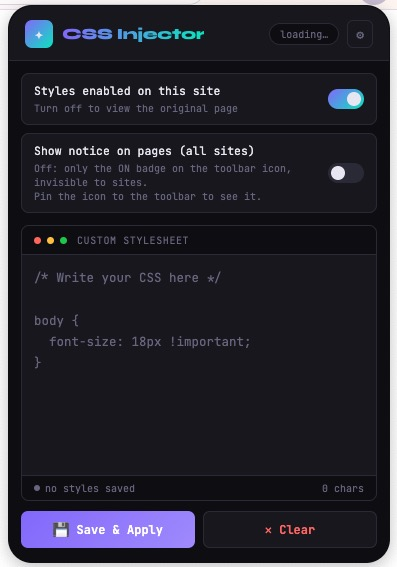

# CSS Injector

A lightweight Firefox extension to add your own CSS to any website. Styles are saved per domain and re-applied automatically every time you come back.

<p align="center">
  
</p>

## Features

- **Per-domain custom CSS:** write CSS for the current site and it is applied on every visit.
- **Live preview:** changes show up on the page while you type, before saving.
- **On/off switch per site:** temporarily disable your styles to see the original page, without losing them.
- **Applied-CSS indicator:** an **ON** badge on the toolbar icon shows when custom CSS is active on the current tab. Optionally, a dismissable *"Custom CSS applied."* notice can also appear in the top-right corner of the page (off by default).
- **Settings page:** review, edit or delete the styles saved for every domain.
- **Privacy-friendly:** CSS is injected outside the page's DOM, so websites can't read your styles or detect the extension (as long as the on-page notice is off).

## Requirements

- **Firefox 142 or later** (desktop).

## Installation

The extension is not yet published on [addons.mozilla.org](https://addons.mozilla.org), so for now it is loaded as a temporary add-on:

1. Download or clone this repository.
2. Open `about:debugging#/runtime/this-firefox` in Firefox.
3. Click **Load Temporary Add-on…** and select the `manifest.json` file in this folder.
4. Optional, but recommended: click the puzzle icon 🧩 in the toolbar and **pin** CSS Injector, so the **ON** badge is visible.

> **Note:** temporary add-ons are removed when Firefox restarts. Repeat step 3 after each restart.

## Usage

1. Open any website and click the CSS Injector icon.
2. Write your CSS in the editor. The page updates as you type.
3. Click **Save & Apply** to keep it for that domain.
4. Use the switches to:
   - **Styles enabled on this site:** turn your styles on or off for the current domain.
   - **Show notice on pages (all sites):** show or hide the in-page notice.
5. Click **⚙** to open the settings page and manage the styles of every domain.

Tip: use `!important` when a site's own styles take precedence over yours.

## Permissions

| Permission | Why it is needed |
|---|---|
| `storage` | Save your CSS, the per-site on/off state and your preferences locally. |
| `<all_urls>` | Inject your CSS into the sites you choose (`tabs.insertCSS`) and read the current tab's domain. |

## Privacy & security

- **No data collection.** Everything is stored locally in your browser (`storage.local`). Nothing is sent anywhere, and the extension makes no remote requests (fonts are bundled).
- **Only the top frame** of each page is styled; iframes are left untouched.
- **Be careful with CSS you didn't write.** CSS can load external resources (`url()`, `@import`, `image-set()`), and combined with attribute selectors that can leak page data to a remote server. The editor shows a warning when your CSS loads external resources. Only use CSS you trust.
- Extensions can't run on some pages: Firefox internal pages (`about:*`), addons.mozilla.org and the built-in PDF viewer.

## Project structure

```
css-injector/
├── manifest.json     # Extension manifest (Manifest V2)
├── background.js     # Injects/removes CSS with tabs.insertCSS, toolbar badge
├── content.js        # Notifies the background on page load, in-page notice
├── popup.html/.js    # Toolbar popup: editor, switches, live preview
├── settings.html/.js # Settings page: manage styles for every domain
├── fonts/            # Bundled fonts + their licenses
├── icons/            # Extension icons
└── docs/             # README images
```

## License

**CSS Injector** © 2026 Enrique Rodríguez Vallejo, licensed under [Creative Commons Attribution 4.0 International (CC BY 4.0)](https://creativecommons.org/licenses/by/4.0/). See [`LICENSE`](LICENSE).

You are free to use, share and adapt this work, including commercially, as long as you give appropriate credit, link to the license and indicate whether changes were made.

### Third-party fonts

The bundled fonts are licensed under the [SIL Open Font License 1.1](https://openfontlicense.org):

| Font | Copyright | License |
|---|---|---|
| [JetBrains Mono](https://github.com/JetBrains/JetBrainsMono) | © 2020 The JetBrains Mono Project Authors | [`fonts/OFL-JetBrainsMono.txt`](fonts/OFL-JetBrainsMono.txt) |
| [Syne](https://gitlab.com/bonjour-monde/fonderie/syne-typeface) | © 2019 The Syne Project Authors | [`fonts/OFL-Syne.txt`](fonts/OFL-Syne.txt) |

The font files were obtained from [Fontsource](https://fontsource.org) and are not covered by the CC BY 4.0 license of this project.
